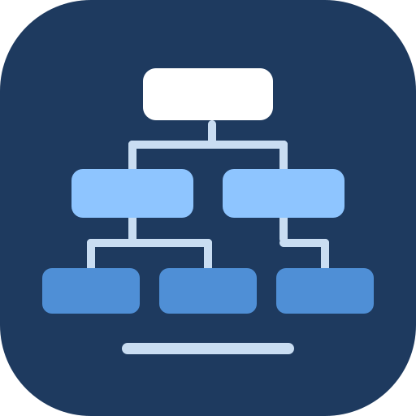
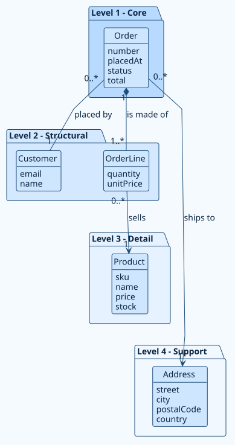
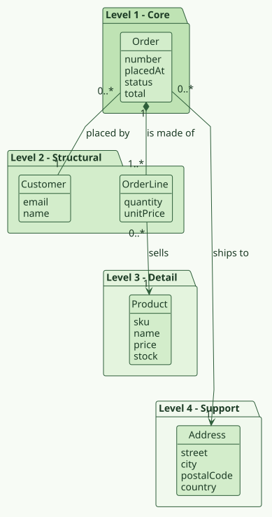
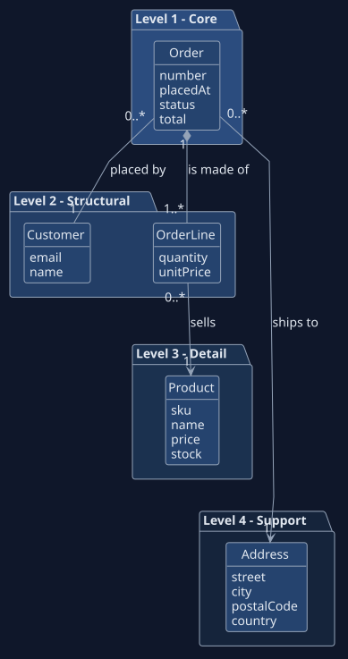

<p align="center"></p>

<h1 align="center">rup-flow</h1>

<p align="center"><b>Stop choosing between documenting your system and building it.</b><br>
rup-flow lets your AI coding agent turn requirements into RUP models and diagrams, models into code, and legacy code back into models, with evidence for every line it writes.</p>

<p align="center">
<a href="https://github.com/hector-ae21/rup-flow/wiki">Documentation</a> ·
<a href="#install-in-one-minute">Install</a> ·
<a href="https://github.com/hector-ae21/rup-flow/wiki/Diagram-Types">Diagram gallery</a> ·
<a href="examples/shop/README.md">Example project</a>
</p>

<p align="center"></p>

## Why you will want it

- **One workflow, both directions.** Requirements to models to code, and code back to models. Documentation and implementation stop drifting apart because the same skill keeps both honest.
- **It never makes things up.** Every statement is marked confirmed, observed in code (`path:line`), assumed or open. Unknown business rules become questions, not invented requirements.
- **Diagrams that look designed.** PlantUML or Mermaid, eight palettes or your own colors, and a double-click interactive explorer with zoom, search and relation highlighting.
- **The same structure every time.** Domain model ranked by importance, actors, use cases with behaviour specs and wireframes, analysis, design, traceability. You choose where it all goes.
- **Works with the agent you already use.** Claude Code, Claude on the web, Codex and Gemini CLI are tested; Cursor and Copilot are supported through instruction files.
- **Nothing to install but Node.** No dependencies. Docker is only needed to draw the diagrams.

## See it

| Domain model by importance | Use-case specification | Design sequence |
| --- | --- | --- |
|  |  |  |

| Ocean | Forest | Dark |
| --- | --- | --- |
|  |  |  |

Eleven diagram types, all explained with images in the [diagram gallery](https://github.com/hector-ae21/rup-flow/wiki/Diagram-Types).

## What you can ask for

| You say | You get |
| --- | --- |
| "Document this system: ..." | Domain model, actors, requirements, use cases, analysis, design and a traceability table |
| "Add the use case cancelOrder" | The use case across every discipline, with the dictionary and traceability updated |
| "Reverse engineer `src/`" | The same documentation derived from your code, each claim cited |
| "Implement UC-001 from the design" | Code, tests and `@rup` trace links generated from the models |
| "Does the code still match the docs?" | A table of differences: model ahead, code ahead, conflict, dead |
| "Audit the documentation" | Findings with evidence, severity, impact and fix |
| "Use Mermaid and the forest theme" | Same documents, new language and palette, re-rendered |

## Install in one minute

| Where | Command |
| --- | --- |
| **Claude Code** | `claude plugin marketplace add hector-ae21/rup-flow` then `claude plugin install rup-flow@rup-flow` |
| **Codex, Gemini CLI and other Agent Skills clients** | `git clone https://github.com/hector-ae21/rup-flow && cd rup-flow && node install.mjs --target agents` |
| **Claude on the web** | Upload `rup-flow-skill.zip` from the [latest release](https://github.com/hector-ae21/rup-flow/releases/latest) in **Customize → Skills** |

Step-by-step guides: [Claude Code](https://github.com/hector-ae21/rup-flow/wiki/Install-in-Claude-Code) · [Claude on the web](https://github.com/hector-ae21/rup-flow/wiki/Install-in-Claude-on-the-Web) · [Codex, Gemini, Cursor, Copilot](https://github.com/hector-ae21/rup-flow/wiki/Other-Agents).

## Your first minute

```
Use rup-flow to document this system in docs/rup, in English:
an online shop where customers place orders for products.
```

It asks only what it cannot know, writes the documentation, draws the diagrams and checks the result. Open `docs/rup/README.md` and follow the links.

## How it works

```
requirements ──► domain model · use cases · analysis · design ──► code
                                  ▲                                │
                                  └────────── reverse ◄────────────┘
```

The skill is written once in the open [Agent Skills](https://agentskills.io/specification) format and adapted per client. A small dependency-free CLI creates the structure, renders the diagrams and checks links and traceability, so the agent spends its effort on analysis and design instead of boilerplate.

## Documentation

Everything lives in the **[wiki](https://github.com/hector-ae21/rup-flow/wiki)**:

[Getting Started](https://github.com/hector-ae21/rup-flow/wiki/Getting-Started) · [Usage Guide](https://github.com/hector-ae21/rup-flow/wiki/Usage-Guide) · [Formats and Themes](https://github.com/hector-ae21/rup-flow/wiki/Formats-and-Themes) · [Interactive Explorer](https://github.com/hector-ae21/rup-flow/wiki/Interactive-Explorer) · [Reference](https://github.com/hector-ae21/rup-flow/wiki/Reference) · [Troubleshooting](https://github.com/hector-ae21/rup-flow/wiki/Troubleshooting) · [Architecture](https://github.com/hector-ae21/rup-flow/wiki/Architecture)

## Honest limits

`check` validates structure, links and traceability gaps. It does not prove that UML is semantically correct or that diagrams have no crossing lines; look at the rendered images. Generated code is only as good as the reviewed models and your tests, and the agent reports what it could not build or run.

## Contributing

Pull requests are welcome; read [CONTRIBUTING.md](CONTRIBUTING.md). Agents working on this repository: [AGENTS.md](AGENTS.md). Security: [SECURITY.md](SECURITY.md). Privacy: [PRIVACY.md](PRIVACY.md).

## License

[MIT](LICENSE)
