# Diagram types

rup-flow produces eleven kinds of diagram, each tied to one RUP discipline. All images on this page were produced by the tool from the [online shop example](../examples/shop/README.md) with the default theme. PlantUML is the default language; Mermaid equivalents are shown where they exist (see [formats and themes](formats-and-themes.md)).

| # | Diagram | Discipline | File | One use case or whole system |
| --- | --- | --- | --- | --- |
| 1 | Domain model | Domain | `domain-model` | Whole system |
| 2 | Simplified domain model | Domain | `domain-model-simple` | Whole system |
| 3 | Entity states | Domain | `entity-states` | One entity |
| 4 | Use-case specification | Requirements | `specification` | One use case |
| 5 | Wireframes | Requirements | `wireframes` | One use case |
| 6 | Analysis classes | Analysis | `class-diagram` | Whole system |
| 7 | Collaboration | Analysis | `collaboration` | One use case |
| 8 | Design classes | Design | `class-diagram` | Whole system |
| 9 | Sequence | Design | `sequence` | One use case |
| 10 | Data model | Design | `data-model` | Whole system |
| 11 | Deployment | Design | `deployment` | Whole system |

## 1. Domain model

The business concepts of the project, arranged top to bottom by **importance to the project objective**: level 1 is what the project cannot exist without, level 4 is support. The position is a reading aid; it is not inheritance or composition. Relations carry multiplicities; attributes that matter are shown, trivial ones are omitted and justified in the entity dictionary.


Write it with one `package` per level, tagged `<<level1>>`…`<<level4>>`, so every theme colours the bands:

```
package "Level 1 - Core" <<level1>> {
  class Order
}
Order "1" *-down- "1..*" OrderLine : is made of
```

Mermaid equivalent: levels become classes tagged `:::level1`…`:::level4`.


## 2. Simplified domain model

Entities and relations only, no attributes. It is the map you show first; the full model is the reference.

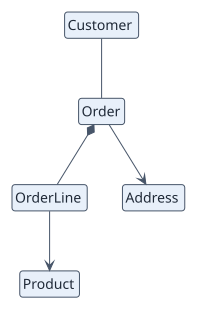

## 3. Entity states

A lifecycle for an entity whose state changes behaviour. Each transition is named after the use case that causes it. Only entities that need it get one.

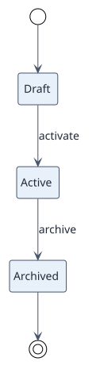

## 4. Use-case specification

The **behavioural source of truth** of a use case: a state diagram that follows the Actor/System conversation, including error and cancel paths. The use-case card must describe the same paths.


Mermaid equivalent:


## 5. Wireframes

A sketch of each screen of the flow, written in PlantUML *salt*. Every field shown maps to a domain attribute or a parameter of the use case. Wireframes are always PlantUML, also in Mermaid projects (Mermaid has no wireframe diagram).

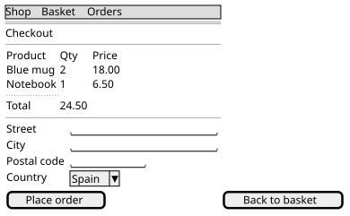

## 6. Analysis classes

The classes that take part in the system, typed as `<<boundary>>` (interface), `<<control>>` (coordination) and `<<entity>>` (domain information). No technology yet.

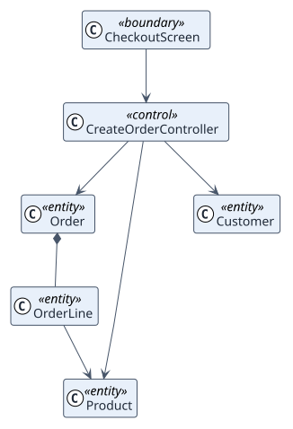

## 7. Collaboration

For one use case: who talks to whom, in numbered order. Shows which boundary, control and entities realise the use case.

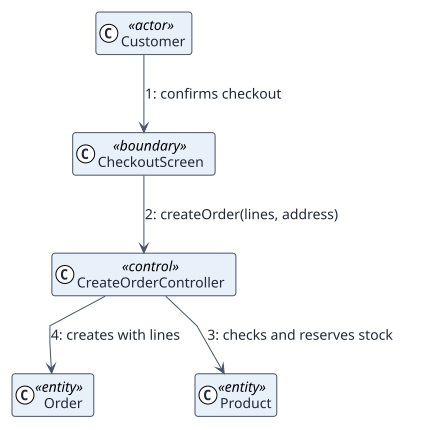

Mermaid equivalent:


## 8. Design classes

The structure that will become code: packages or layers, operations and interfaces where a dependency is inverted. Its shape follows the architecture decision recorded in the quality folder.

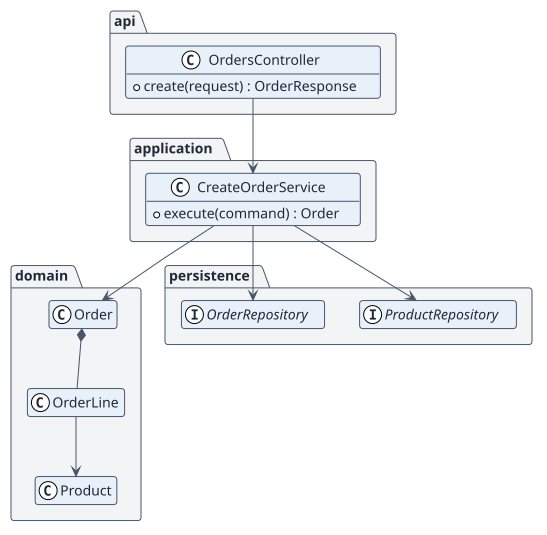

## 9. Sequence

The messages between concrete design elements for one use case, with the failure path and the transaction boundary. Code generation follows this diagram step by step.


Mermaid equivalent:

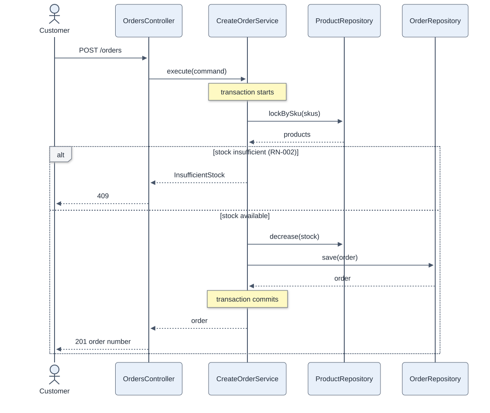

## 10. Data model

Tables or collections, keys and constraints, mapped from the domain entities.

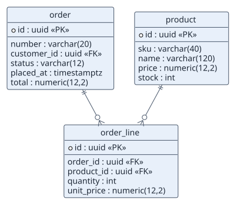

Mermaid equivalent (an `erDiagram`):


## 11. Deployment

Nodes, containers, external systems and the protocols between them.

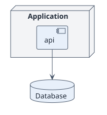

Mermaid equivalent:


## Choosing a language per diagram

| | PlantUML | Mermaid |
| --- | --- | --- |
| Renderer | PlantUML server (Docker) | mermaid-cli (Docker) |
| Wireframes | Yes (salt) | No: stay PlantUML, so the PlantUML server is still needed |
| GitHub renders the source natively | No (you embed the SVG) | Yes in fenced code blocks, but rup-flow embeds the SVG so both look identical |
| Level colours in the domain model | Packages per level | Classes tagged per level |
| Best for | Statecharts, layered class diagrams, packages | Quick sequence, ER and flow diagrams |

The default is PlantUML for everything. Choose Mermaid for the whole project with `diagrams.language`; wireframes remain PlantUML. You can also mix by hand: `render` handles `.puml` and `.mmd` side by side.
