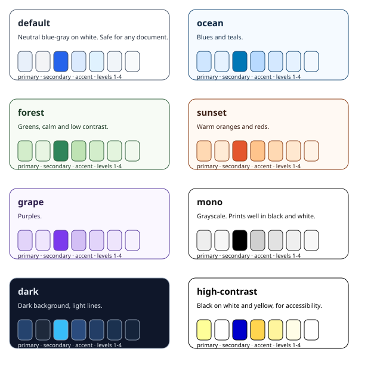
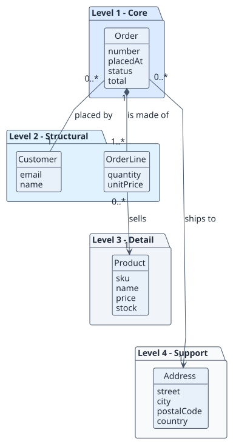
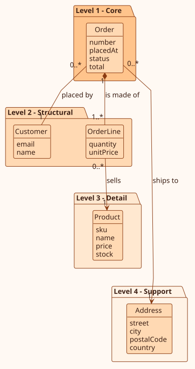
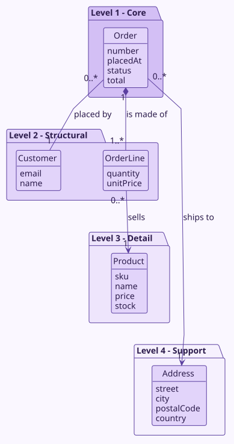
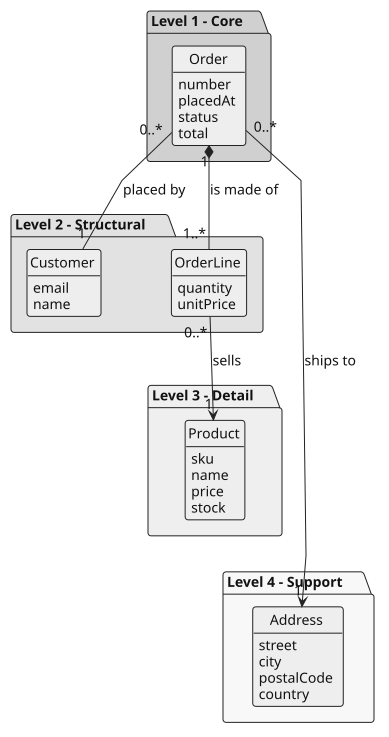
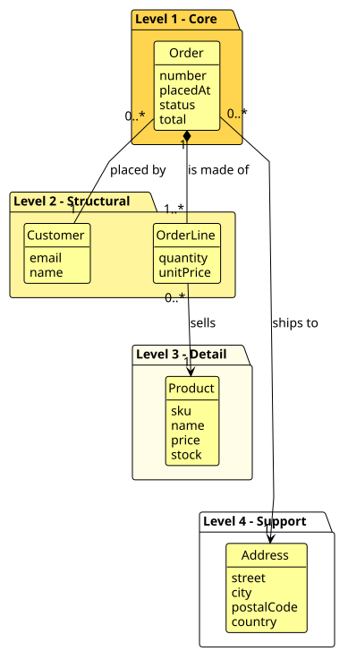
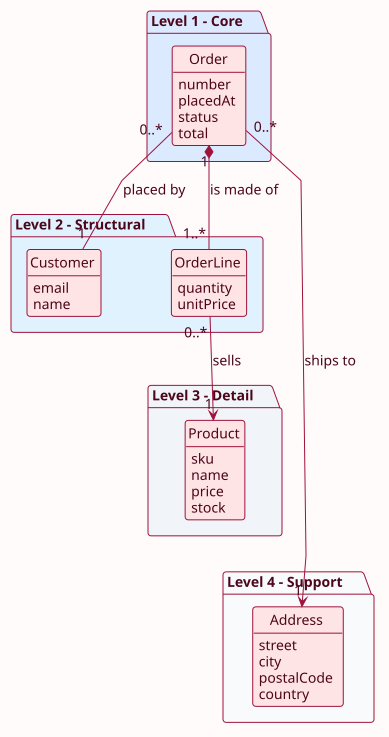
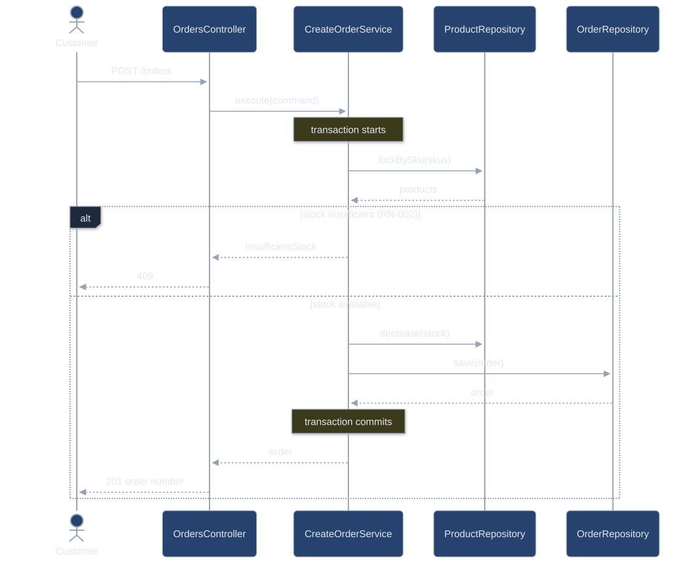

# Formats, outputs and themes

Three things are configurable independently:

| What | Setting | Values |
| --- | --- | --- |
| The diagram **language** Claude writes | `diagrams.language` | `plantuml` (default), `mermaid` |
| The **outputs** `render` produces | `diagrams.outputs` | `svg` (default, always what the Markdown embeds), `png` (preview next to each SVG), `html` (interactive [explorer](explorer.md)) |
| The **look** | `theme` | a preset, color overrides, font, size |

## Set them

In `rup.config.json`:

```json
{
  "diagrams": { "language": "mermaid", "outputs": ["svg", "html"] },
  "theme": {
    "preset": "ocean",
    "colors": { "accent": "#0077B6" },
    "font": "Verdana, Arial, sans-serif",
    "fontSize": 14,
    "roundCorner": 6
  }
}
```

By flag (for `init`, `render`, `explore`):

```bash
node rup.mjs init --diagram-language mermaid --theme forest --outputs svg,html
node rup.mjs render --theme sunset --force
node rup.mjs render --color-primary "#FFE4E6" --color-accent "#BE123C"
```

Or in your prompt: "Use rup-flow with Mermaid diagrams, the sunset theme and an interactive explorer."

Changing the theme re-renders every diagram automatically (the theme fingerprint is remembered in `<outDir>/.rup-render-state.json`). Sources are never modified: the theme is applied at render time, so you can switch palettes without touching a diagram.

## Output formats

| Output | What you get | Notes |
| --- | --- | --- |
| `svg` | `name.svg` next to each source | Embedded by the Markdown. Vector, searchable text |
| `png` | `name.preview.png` next to each PlantUML SVG | For decks or tools that do not take SVG. PlantUML only |
| `html` | `explorer.html` in the documentation root | One self-contained page: pan, zoom, search, highlight relations. See [explorer](explorer.md) |

## Theme presets



List them with `node rup.mjs themes`. The same domain model in every preset:

| default | ocean | forest | sunset |
| --- | --- | --- | --- |
|  |  |  |  |

| grape | mono | dark | high-contrast |
| --- | --- | --- | --- |
|  |  |  |  |

| Preset | Use it for |
| --- | --- |
| `default` | Any document |
| `ocean`, `forest`, `sunset`, `grape` | Brand or taste |
| `mono` | Print in black and white |
| `dark` | Dark-mode sites and slides |
| `high-contrast` | Accessibility |

## Your own palette

Override any of eight colors, or the four level colors, on top of a preset:

| Key | Colors |
| --- | --- |
| `background` | Diagram background |
| `text` | All text |
| `line` | Arrows and relation lines |
| `border` | Borders of boxes and packages |
| `primary` | Fill of classes, states, participants |
| `secondary` | Fill of packages, groups, secondary boxes |
| `accent` | Highlight color (explorer selection, search hits) |
| `note` | Fill of notes |
| `levels` | Four fills for the domain-model bands, level 1 to 4 |

All values are `#RRGGBB`. A custom rose palette:

```json
{ "theme": { "preset": "default", "colors": {
  "background": "#FFFBFB", "text": "#4C0519", "line": "#9F1239", "border": "#9F1239",
  "primary": "#FFE4E6", "secondary": "#FFF1F2", "accent": "#BE123C" } } }
```



## Themes in Mermaid

The same palette drives Mermaid through its theme variables. Forest in Mermaid, and the dark preset on a sequence diagram:

| Forest | Dark |
| --- | --- |
|  |  |

## Fonts

`theme.font` (default Verdana) and `theme.fontSize` apply to every diagram. PlantUML needs the font installed in the server container; the default and generic families always work.

## Interactive output

See [the explorer](explorer.md).

## What stays fixed

- Wireframes are PlantUML salt and are drawn without the theme. In a Mermaid project they still need the PlantUML server.
- Folder names, file names and front matter do not depend on the language or theme.
- Markdown always links `.svg` files, so documents read the same in either language.
