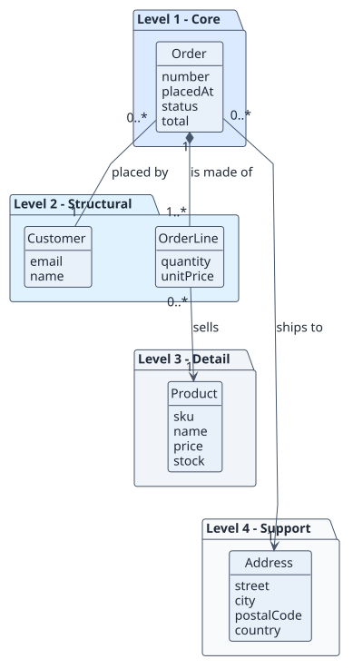

# Domain model

## Purpose

Business concepts of a small online shop where customers place orders for products. It feeds the use cases in [requirements](../01-requirements/README.md).

## Hierarchy of entities

The vertical position expresses importance to the project objective ("let customers buy products and let the shop fulfil orders"). It is not inheritance or composition.

| Level | Meaning | Entities | Why they are here |
| --- | --- | --- | --- |
| 1 | Core | Order | Without orders there is no shop |
| 2 | Structural | Customer, OrderLine | An order is placed by a customer and made of lines |
| 3 | Detail | Product | Qualifies what a line sells |
| 4 | Support | Address | Where the order ships; replaceable without changing the business meaning |

## Diagrams

## Entity dictionary

| Entity | Level | Definition | Key attributes | Omitted attributes and why |
| --- | --- | --- | --- | --- |
| Order | 1 | A customer's request to buy products | number, placedAt, status, total | Notes: free text, no rule depends on it |
| Customer | 2 | Person who places orders | email, name | Phone: not used by any use case |
| OrderLine | 2 | One product and quantity within an order | quantity, unitPrice | none |
| Product | 3 | Item for sale | sku, name, price, stock | Description and images: catalogue concern |
| Address | 4 | Shipping destination | street, city, postalCode, country | none |

## Business rules

| ID | Rule | Entities | Source |
| --- | --- | --- | --- |
| RN-001 | An order has at least one line | Order, OrderLine | confirmed |
| RN-002 | A line quantity does not exceed the product stock | OrderLine, Product | confirmed |
| RN-003 | The unit price of a line is the product price at the time of ordering | OrderLine, Product | assumed |

## Lifecycles

Order states: Draft → Placed → Shipped → Delivered, or Placed → Cancelled. Draft is not persisted (assumed).
