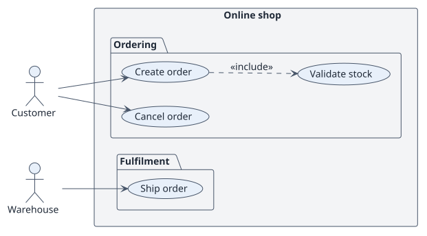
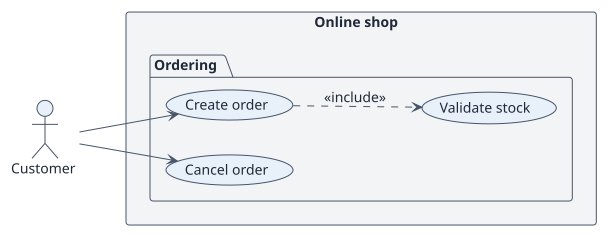
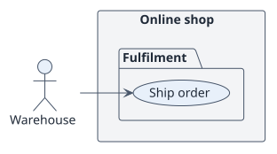

# Requirements

## Index

- [Actors](./actors.md)
- [Requirements catalogue](./requirements.md)

## Use cases

<!-- rup-flow:use-cases:start -->

| ID | Use case | Actor | Package | Requirement | Analysis | Design | Implementation | Status |
| --- | --- | --- | --- | --- | --- | --- | --- | --- |
| UC-001 | [Create order](./use-cases/createOrder/README.md) | Customer | Ordering | RF-001 | [card](../02-analysis/use-cases/createOrder/README.md) | [card](../03-design/use-cases/createOrder/README.md) | [card](../04-implementation/use-cases/createOrder/README.md) | reviewed |
| UC-002 | [Validate stock](./use-cases/validateStock/README.md) | Customer | Ordering | RF-001 | [card](../02-analysis/use-cases/validateStock/README.md) | [card](../03-design/use-cases/validateStock/README.md) | [card](../04-implementation/use-cases/validateStock/README.md) | draft |
| UC-003 | [Cancel order](./use-cases/cancelOrder/README.md) | Customer | Ordering | RF-002 | [card](../02-analysis/use-cases/cancelOrder/README.md) | [card](../03-design/use-cases/cancelOrder/README.md) | [card](../04-implementation/use-cases/cancelOrder/README.md) | draft |
| UC-004 | [Ship order](./use-cases/shipOrder/README.md) | Warehouse | Fulfilment | RF-003 | [card](../02-analysis/use-cases/shipOrder/README.md) | [card](../03-design/use-cases/shipOrder/README.md) | [card](../04-implementation/use-cases/shipOrder/README.md) | draft |

### Use-case diagram

### By actor

#### Customer

#### Warehouse

<!-- rup-flow:use-cases:end -->

## Conventions

- `specification.puml` is the behavioural source of truth of a use case: a statechart with the Actor/System conversation.
- `wireframes.puml` is the interface prototype, even when it holds a single screen.
- Each use-case folder holds `README.md`, `specification.puml` and `wireframes.puml`.
