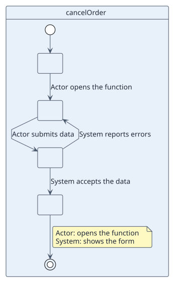

# UC-003 Cancel order

| Overview | Requirements | Analysis | Design | Implementation | Tests |
| --- | --- | --- | --- | --- | --- |
| [Use cases](../../../01-requirements/use-case-overview.svg) | **Requirements** | [Analysis](../../../02-analysis/use-cases/cancelOrder/README.md) | [Design](../../../03-design/use-cases/cancelOrder/README.md) | [Implementation](../../../04-implementation/use-cases/cancelOrder/README.md) | [Tests](../../../04-implementation/use-cases/cancelOrder/README.md#tests) |

## Use-case information

| Field | Value |
| --- | --- |
| Actor | Customer |
| Package | Ordering |
| Goal | Withdraw a placed order and release its stock |
| Type | Primary / Secondary, essential / real |
| Level | Summary / User goal / Subfunction |
| Requirement | RF-002 |
| Domain entities | |

## Context

Why the actor does this and where it fits in the business.

## Preconditions

- 

## Postconditions

- Success:
- Failure:

## Main flow

| Step | Actor | System |
| --- | --- | --- |
| 1 | | |

## Alternative flows

| ID | Starts at step | Condition | Behaviour | Ends |
| --- | --- | --- | --- | --- |
| A1 | | | | |

## Business rules

| ID | Rule |
| --- | --- |
| RN-001 | |

## Specification

Behaviour source of truth: [specification.puml](./specification.puml)

## Wireframes

## Pending

| Question | Blocks |
| --- | --- |
| | |
