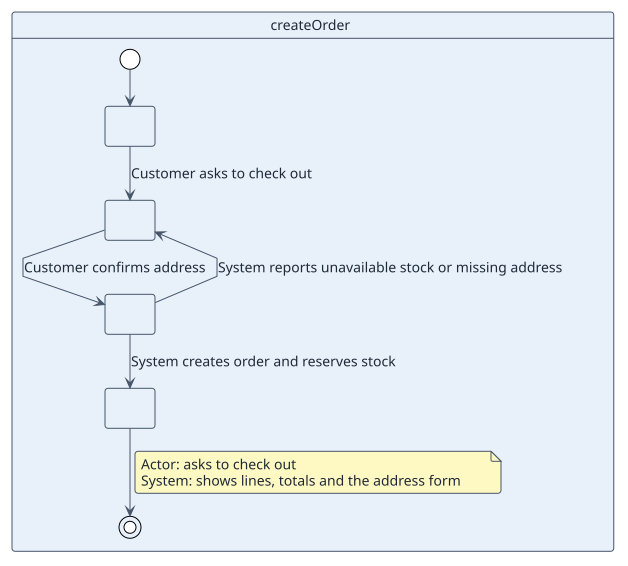

# UC-001 Create order

| Field | Value |
| --- | --- |
| Actor | Customer |
| Goal | Place an order for the products in the basket |
| Type | Primary, essential |
| Level | User goal |
| Requirement | RF-001 |
| Domain entities | Order, OrderLine, Customer, Product, Address |

## Context

The customer has chosen products and wants the shop to take the order and reserve the stock.

## Preconditions

- The customer is signed in.
- The basket has at least one product.

## Postconditions

- Success: an Order in `Placed` status exists with its lines, and the stock of each product is reduced.
- Failure: no order exists and no stock changed.

## Main flow

| Step | Actor | System |
| --- | --- | --- |
| 1 | Asks to check out | Shows basket lines, totals and the shipping address form |
| 2 | Chooses or enters a shipping address and confirms | Validates lines, stock and address |
| 3 | | Creates the order, reserves stock, shows the order number |

## Alternative flows

| ID | Starts at step | Condition | Behaviour | Ends |
| --- | --- | --- | --- | --- |
| A1 | 2 | A line exceeds stock (RN-002) | Shows which lines cannot be served | Returns to step 1 |
| A2 | 2 | Address is incomplete | Highlights missing fields | Returns to step 1 |

## Business rules

| ID | Rule |
| --- | --- |
| RN-001 | An order has at least one line |
| RN-002 | A line quantity does not exceed the product stock |
| RN-003 | The unit price is the product price at the time of ordering |

## Specification

Behaviour source of truth: [specification.puml](./specification.puml)

## Wireframes

## Pending

| Question | Blocks |
| --- | --- |
| Is payment part of this use case? See [Q-001](../../../05-quality/open-questions.md) | Postconditions |
