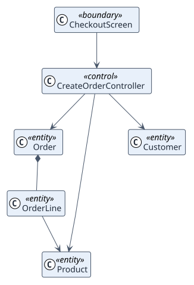

# Analysis

## Analysis classes

Stereotypes: `<<boundary>>` interface, `<<control>>` coordination, `<<entity>>` domain information.

## Use-case realizations

| ID | Use case | Collaboration |
| --- | --- | --- |
| UC-001 | createOrder | [collaboration](./use-cases/createOrder/README.md) |
