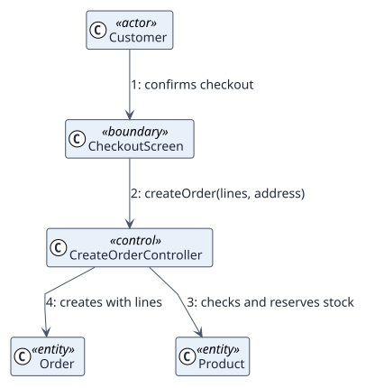

# UC-001 Create order — analysis realization

| Overview | Requirements | Analysis | Design | Implementation | Tests |
| --- | --- | --- | --- | --- | --- |
| [Use cases](../../../01-requirements/use-case-overview.svg) | [Requirements](../../../01-requirements/use-cases/createOrder/README.md) | **Analysis** | [Design](../../../03-design/use-cases/createOrder/README.md) | [Implementation](../../../04-implementation/use-cases/createOrder/README.md) | [Tests](../../../04-implementation/use-cases/createOrder/README.md#tests) |

Requirements: [README](../../../01-requirements/use-cases/createOrder/README.md)

## Participating classes

| Class | Stereotype | Responsibility |
| --- | --- | --- |
| CheckoutScreen | boundary | Shows lines and collects the shipping address |
| CreateOrderController | control | Validates, creates the order and reserves stock |
| Order, OrderLine | entity | Hold the order and enforce RN-001 |
| Product | entity | Holds stock and price, enforces RN-002 |

## Collaboration

## Notes

Transaction handling and the stock reservation strategy are decided in design.
