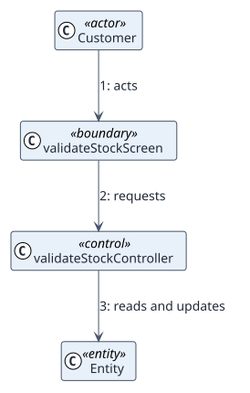

# UC-002 Validate stock — analysis realization

| Overview | Requirements | Analysis | Design | Implementation | Tests |
| --- | --- | --- | --- | --- | --- |
| [Use cases](../../../01-requirements/use-case-overview.svg) | [Requirements](../../../01-requirements/use-cases/validateStock/README.md) | **Analysis** | [Design](../../../03-design/use-cases/validateStock/README.md) | [Implementation](../../../04-implementation/use-cases/validateStock/README.md) | [Tests](../../../04-implementation/use-cases/validateStock/README.md#tests) |

Requirements: [README](../../../01-requirements/use-cases/validateStock/README.md)

## Participating classes

| Class | Stereotype | Responsibility |
| --- | --- | --- |
| | boundary / control / entity | |

## Collaboration

## Notes

Decisions that analysis leaves to design.
