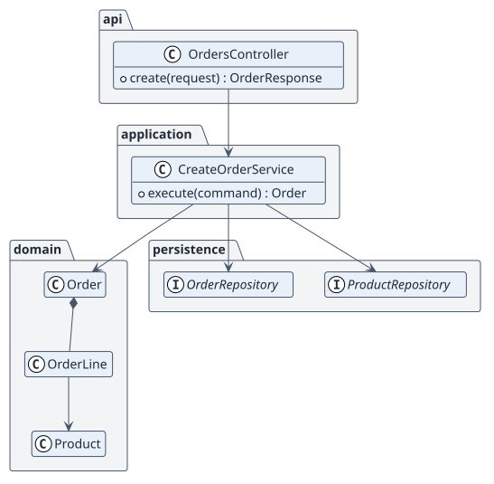
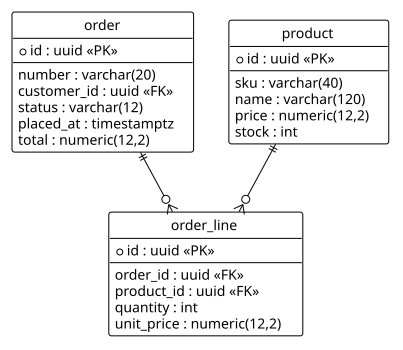

# Design

## Architecture

Layered by feature: `api` (controllers), `application` (use-case services), `domain` (entities), `persistence` (repositories). Stack decisions are in [project-configuration.md](./project-configuration.md).

## Design classes

## Data model

## Deployment

## Use-case realizations

| ID | Use case | Sequence |
| --- | --- | --- |
| UC-001 | createOrder | [sequence](./use-cases/createOrder/README.md) |

## Project configuration

See [project-configuration.md](./project-configuration.md).
