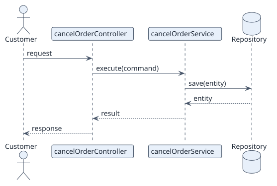

# UC-003 Cancel order — design realization

| Overview | Requirements | Analysis | Design | Implementation | Tests |
| --- | --- | --- | --- | --- | --- |
| [Use cases](../../../01-requirements/use-case-overview.svg) | [Requirements](../../../01-requirements/use-cases/cancelOrder/README.md) | [Analysis](../../../02-analysis/use-cases/cancelOrder/README.md) | **Design** | [Implementation](../../../04-implementation/use-cases/cancelOrder/README.md) | [Tests](../../../04-implementation/use-cases/cancelOrder/README.md#tests) |

Analysis: [README](../../../02-analysis/use-cases/cancelOrder/README.md)

## Elements

| Design element | Kind | Code target |
| --- | --- | --- |
| | controller / service / repository / DTO | `path/to/file` |

## Sequence

## Contracts

| Operation | Input | Output | Errors |
| --- | --- | --- | --- |
| | | | |

## Data touched

| Table or entity | Operation |
| --- | --- |
| | |
