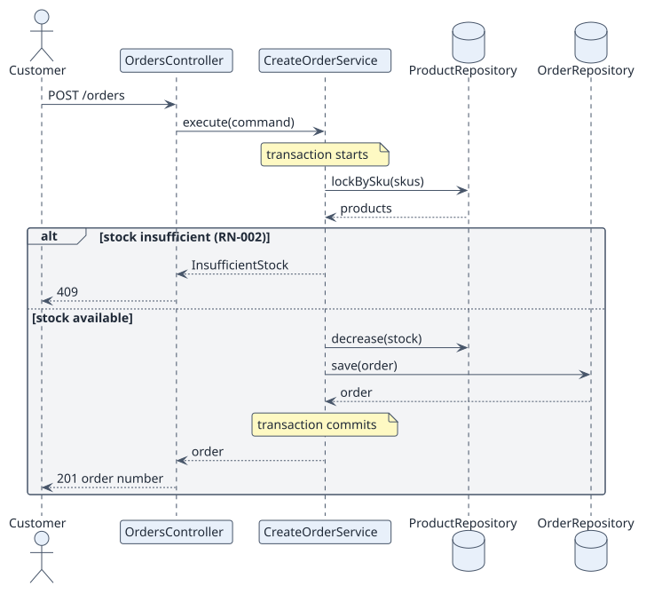

# UC-001 Create order — design realization

| Overview | Requirements | Analysis | Design | Implementation | Tests |
| --- | --- | --- | --- | --- | --- |
| [Use cases](../../../01-requirements/use-case-overview.svg) | [Requirements](../../../01-requirements/use-cases/createOrder/README.md) | [Analysis](../../../02-analysis/use-cases/createOrder/README.md) | **Design** | [Implementation](../../../04-implementation/use-cases/createOrder/README.md) | [Tests](../../../04-implementation/use-cases/createOrder/README.md#tests) |

Analysis: [README](../../../02-analysis/use-cases/createOrder/README.md)

## Elements

| Design element | Kind | Code target |
| --- | --- | --- |
| OrdersController | controller | `src/api/orders.controller.ts` |
| CreateOrderService | service | `src/application/create-order.service.ts` |
| Order, OrderLine, Product | entities | `src/domain/` |
| OrderRepository, ProductRepository | repositories | `src/persistence/` |

## Sequence

## Contracts

| Operation | Input | Output | Errors |
| --- | --- | --- | --- |
| POST /orders | lines[{sku, quantity}], address | order number, total | 409 insufficient stock, 422 invalid address or no lines |

## Data touched

| Table | Operation |
| --- | --- |
| product | read, update stock |
| order, order_line | insert |
